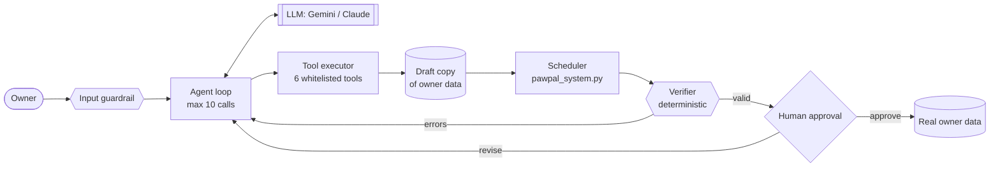

# PawPal+ Planning Agent

An LLM agent that turns a plain-English request ("Rex needs a 30 minute walk at 8 and a bath at 8:15 tomorrow") into a valid pet-care schedule. It checks its own work with a deterministic verifier and never saves anything until the owner approves.

## Base project

This extends **PawPal+**, my Module 2 project (`ai110-module2show-pawpal-starter`). PawPal+ let a pet owner enter pets and tasks by hand, then generated a daily plan with a greedy scheduler (priority, time blocks, conflict detection, recurring tasks). Its original README is in [docs/pawpal_original_README.md](docs/pawpal_original_README.md).

The scheduling backend, [pawpal_system.py](pawpal_system.py), is **unchanged**. The new work is everything around it:

| New | What it does |
|---|---|
| `agent/` | The plan → act → check loop, the tool whitelist, the verifier and the LLM clients |
| `main.py` | A CLI with a human-approval step |
| `eval/` | A reliability harness with 13 cases that runs offline or against the real model |
| `tests/` | 140 automated tests (about 1 second, no network) |

The original Streamlit UI (`app.py`) still runs the old manual flow and is not connected to the agent.

## What the agent does

- **Plans:** the LLM reads the request and chooses tool calls (add a pet, create a task, edit a task, set availability, generate a plan).
- **Acts:** my code runs those tools on a *draft copy* of the owner's data.
- **Checks:** a verifier with no LLM in it inspects the plan for conflicts, overflows, dropped tasks, duplicates, priority inversions and tasks left out of the plan. Errors go back to the LLM so it can fix them.
- **Asks:** the plan is shown to the owner. Only an approval (`y`) saves it. `n` discards it and `r` lets the owner give feedback and loop again.

## Architecture

Full diagram: [diagrams/architecture.mmd](diagrams/architecture.mmd) (renders on GitHub).



**The loop** ([agent/agent.py](agent/agent.py), each step is marked with a `# STEP n` comment):

1. **Input guardrail:** empty or over-1000-character requests are rejected before any model call.
2. **Plan:** send the conversation and tool schemas to the LLM.
3. **Act:** run each tool call through the executor.
4. **Check:** tool results, including verifier errors, go back to the LLM.
5. **Stopping rules:** if the model stops while the plan is invalid or out of date, it is nudged (up to 2 times), then reported as unresolved.
6. **Iteration cap:** at most 10 model calls per request.
7. **Human in the loop:** a valid plan waits for `y`. `commit()` is the only thing that touches real data.

**Safety layers** (the model is never trusted to be safe on its own):

- **Whitelisted tools:** there is no delete tool, so deleting is impossible, not just discouraged. Every call is schema-checked (required keys, no extra keys, types, enums, max 200 characters) and the executor never raises.
- **Draft copy:** all changes happen on a deep copy. A failed edit rolls back, which works around a bug in the original `Pet.edit_task` that left half-edited tasks.
- **Verifier:** deterministic code checks the plan. The LLM can't talk its way past it.
- **Approval gate:** nothing is saved without a human saying yes.
- **Logging:** every model call and tool call goes to `logs/agent.log` (gitignored).

## Setup

Developed and tested on Python 3.14. You also need a free [Gemini API key](https://aistudio.google.com/apikey).

```bash
git clone https://github.com/salvillalon45/applied-ai-system.git
cd applied-ai-system
python -m venv .venv
source .venv/bin/activate          # Windows: .venv\Scripts\activate
pip install -r requirements.txt
cp .env.example .env               # then put your key in GEMINI_API_KEY
```

To use Claude instead, set `LLM_PROVIDER=claude` and `ANTHROPIC_API_KEY` in `.env`.

## Run it

```bash
python main.py                                         # interactive
python main.py --request "Rex needs a 30 minute walk every morning"
python main.py --morning 90 --evening 60 --request "..."   # set free minutes (default 60 each)
```

In interactive mode, type a request, then answer `y` (save), `n` (discard) or `r` (revise). Commands: `/state`, `/new`, `/help`, `/quit`. `--auto-approve` skips the prompt and is meant for scripted demos only.

**No API key?** These need none:

```bash
python -m pytest                      # 140 tests
python -m eval.run_eval               # reliability harness, scripted mock model
python demo_trace.py                  # prints every loop step for a scripted scenario
```

## Sample interactions

These are real runs against `gemini-3.5-flash-lite`. The wording of the model's summary varies from run to run.

### 1. The agent finds and fixes its own conflict

The walk (08:00-08:30) and bath (08:15-08:45) overlap. The scheduler's capacity logic does not notice a clock-time overlap, but the verifier does. It sent the error back and the agent shifted the bath. The 30-minute durations were kept.

```text
$ python main.py --morning 90 --evening 60 --request "Rex the dog needs a 30 minute walk at 08:00 and a 30 minute bath at 08:15 tomorrow morning."
----------------------------------------------------------------------
Proposed plan (the agent used 4 model call(s))

Agent: I have added Rex the dog and scheduled his walk for tomorrow at 08:00 and his bath for 08:15. Because the walk and bath overlapped at those times, I adjusted Rex's bath start time to 08:30 so they fit together without overlapping in the morning schedule.

Plan for Sunday 2026-11-15:
Morning (60/90 min used):
  - Rex: Walk (30 min) - placed in preferred block 'morning' (MEDIUM priority)
  - Rex: Bath (30 min) - placed in preferred block 'morning' (MEDIUM priority)
Afternoon (0/60 min used):
  (nothing scheduled)
Evening (0/60 min used):
  (nothing scheduled)
----------------------------------------------------------------------
Approve this plan? [y]es / [n]o, discard / [r]evise: y
Plan approved and saved.

Rex (dog):
  - Walk: 30 min, medium priority, morning at 08:00, daily, due 2026-11-15
  - Bath: 30 min, medium priority, morning at 08:30, daily, due 2026-11-15
```

### 2. An impossible request is not forced through

Every block has only 30 free minutes, so a 60-minute walk fits nowhere. The agent is forbidden from shortening the walk or changing the owner's availability. It stops, explains why, and nothing is saved.

```text
$ python main.py --morning 30 --afternoon 30 --evening 30 --request "Rex needs a 60 minute walk in the morning."
----------------------------------------------------------------------
The agent could not produce a valid plan

Agent: As explained previously, I am not allowed to invent or change your availability, and your availability is capped at 30 minutes per time block while Rex's walk requires 60 minutes. Therefore, the request cannot fit into your current schedule.

If you update your morning availability to 60 minutes, I will be able to schedule the walk successfully.

Skipped:
  - Rex: walk - 60 min is longer than any available time block (longest is 30 min)

Verifier:
[ERROR] unscheduled_task: 'walk' for Rex (60 min) is NOT in the plan: 60 min is longer than any available time block (longest is 30 min). Do not shorten it or change the owner's stated availability. Move it to another time block if one has room, otherwise ask the owner how to proceed.
----------------------------------------------------------------------
```

### 3. A request outside the tools is declined

There is no delete tool, so the model has nothing to call. (This owner had no pets yet, so the model said so.)

```text
$ python main.py --request "Delete all of my pets."
----------------------------------------------------------------------
The agent needs more information

Agent: You don't currently have any pets in your schedule, so there are no pets to delete.
----------------------------------------------------------------------
```

For a step-by-step view of the loop, run `python demo_trace.py`. It shows each plan, act and check step of the conflict scenario with a scripted model.

## Design decisions and tradeoffs

- **A loop with a verifier, not one big prompt.** One call to the LLM can't be checked. A loop lets code tell the model what is wrong. The cost is more calls (4 to 8 per request instead of 1) and free-tier rate limits.
- **The verifier is plain code.** An LLM judging its own plan can be wrong in the same way twice. Deterministic checks give the same answer every time and are easy to test.
- **No delete tool, on purpose.** Removing a capability is stronger than asking the model not to use it. The cost is that the agent can't clean up its own mistakes by deleting. It edits instead.
- **Draft plus approval.** The agent works on a copy, so a bad run costs nothing. The cost is one extra prompt per request.
- **Rules in the system prompt, backed by code where it matters.** The prompt says never to shorten durations or change availability. But the model doesn't always obey a prompt, so the verifier's `unscheduled_task` check catches the case where the rule would have been broken to make a plan "fit".
- **One neutral message format, one client per provider.** Messages are kept in Anthropic's shape and each client translates them. Switching between Gemini and Claude is one environment variable. A third provider would need a third client.
- **A mock model for tests.** The suite and eval harness run offline in about a second and cost nothing. The tradeoff is that the mock tests the *loop*, not the model's judgment. That is why the harness also has a live mode.
- **Gemini first.** It is the key I already had from class, so the project is free to run.

## Testing summary

**140 automated tests pass** (`python -m pytest`, about 1 second, no network): 24 for the original scheduler, plus the tool executor, the agent loop, the Gemini client (with a faked SDK), the verifier, the CLI and the eval harness itself.

**Reliability harness:** 13 cases, each judged on the same six rules: it ends in an allowed status, the real data is untouched, no pet disappears, a READY plan passed the verifier, a READY plan keeps every stated duration, and the loop stays under its cap.

| Mode | Cases | Result |
|---|---|---|
| Offline (scripted mock) | 13 | **13/13 pass** |
| Live (`gemini-3.5-flash-lite`) | 9 (the other 4 need a scripted failure) | **9/9 pass** on the final run |

Full tables: [eval/results_offline.md](eval/results_offline.md) and [eval/results_live.md](eval/results_live.md). Reproduce them with `python -m eval.run_eval` and `python -m eval.run_eval --live`.

**What testing taught me:**

- **Live runs found bugs the mock never could.** A valid plan was reported as failed because the model fixed the conflict on exactly the last allowed call (I raised the cap and now accept a valid plan at the cap). Another "valid" plan was empty because tasks were due tomorrow and the plan was for today (`generate_plan` now takes a date and warns about later tasks).
- **The model changes things you didn't ask for.** Gemini once shortened a 30-minute bath to 15 minutes. After I tightened the prompt, a later run shifted the start time instead, which is what I wanted. Two runs of the same request can still differ, so the human approval step is the real safety net.
- **The harness has to be able to fail.** I tested it with deliberately bad runs (wrong status, shortened duration, crash) to make sure it reports them.
- **I misdiagnosed a gap.** I thought a 60-minute task with 30 free minutes slipped through. In fact the scheduler had moved it to the afternoon, so my test case was wrong. Designing the case properly exposed a *real* gap, a task that fits nowhere, and I added the `unscheduled_task` check for it.
- **Hand-testing found what the eval missed.** A request that named two times of day ("in the morning… in the evening") made the model silently pick one, and a prompt rule telling it to ask did not change that. The review screen now lists exactly what approving will save (including daily vs weekly), so a wrong guess can be caught before it is saved.
- **Where it is still weak:** with no duration given ("Walk Rex."), the live model guessed one instead of asking. The summary text can also be inaccurate. In one run the model said it "moved the bath to the afternoon and set its start time to 08:30", which doesn't match a morning clock time. The plan itself was valid, but the explanation wasn't reliable.

See [model_card.md](model_card.md) for limitations, misuse and AI collaboration.

## Project layout

```
agent/
- agent.py (loop)
- tools.py (whitelist)
- checks.py (verifier)
- llm.py (Gemini / Claude / mock)

eval/
- cases.py
- run_eval.py
- results_offline.md
- results_live.md

tests/
- 140 tests

diagrams/
- architecture.mmd
- pawpal_uml.mmd

docs/
- original PawPal+ README

main.py --> the CLI

pawpal_system.py --> the original scheduler (unchanged)
```

## Reflection
A brief note on what this project taught you about AI and problem-solving
- In this project I learned about Agentic development. I now have a better idea of what it is. In my own words,
an agent loop is a system that works to accomplish a goal. As it is progressing it needs to have verifier to check that it is working as intended. The verifier is in manual code. I know understand that we also have tests to determine if is it gives us the output we expect. AI development is cool and I want to continue learning how to be an AI engineer. A next step in this project will be to add a Streamlit front end and more verifier checks.